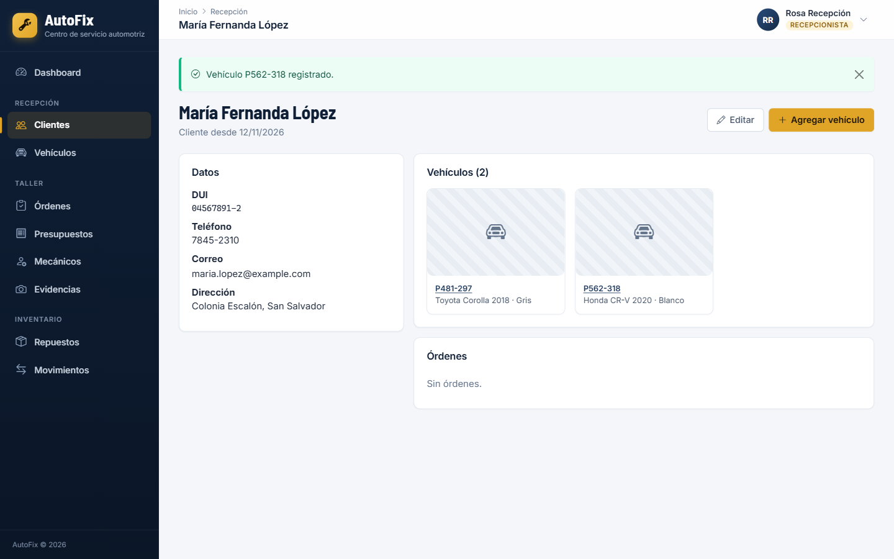
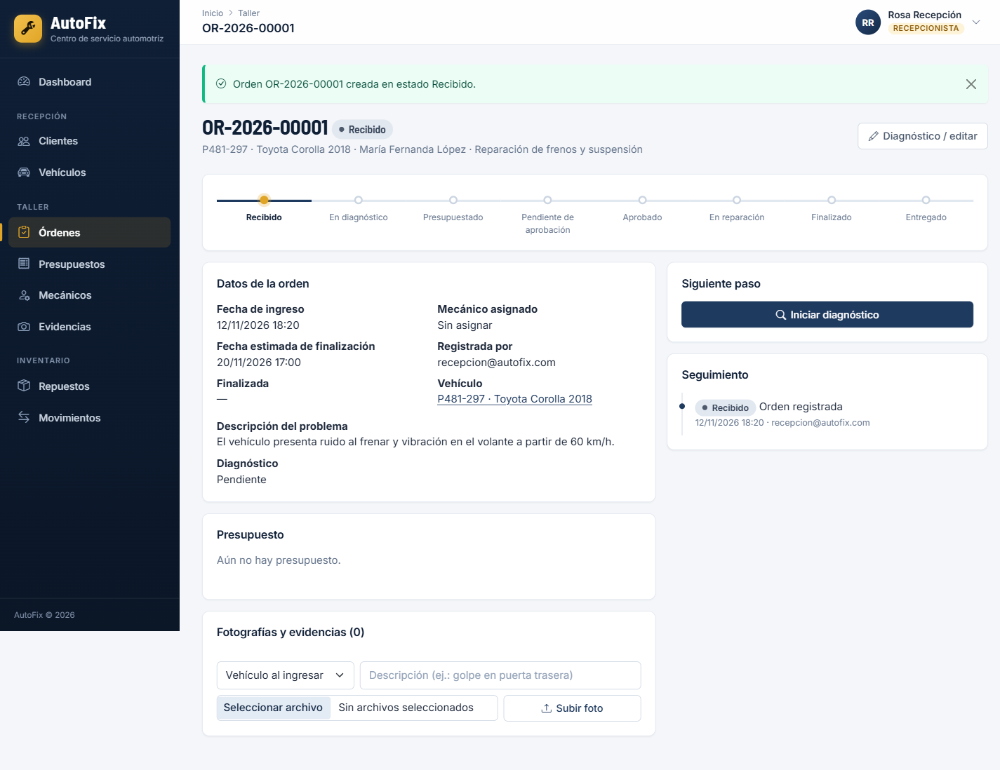
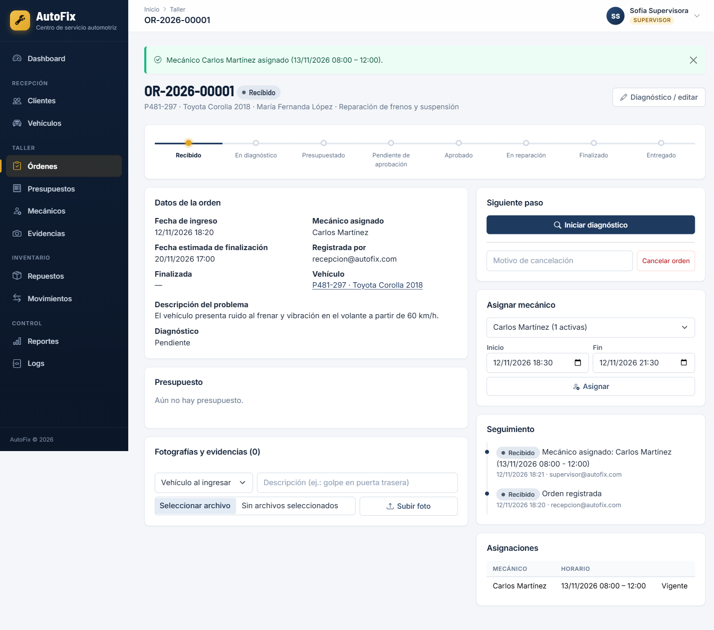
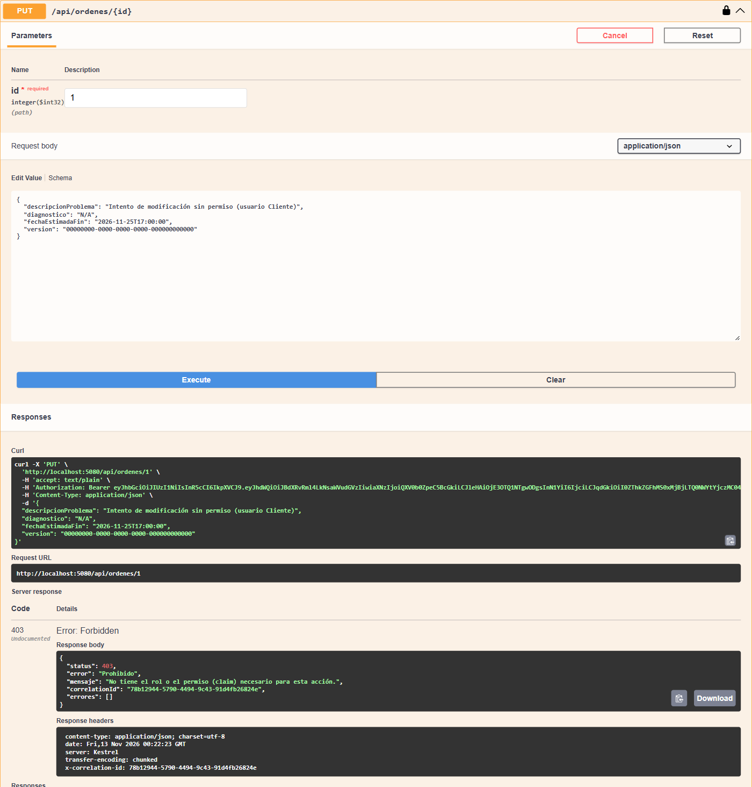
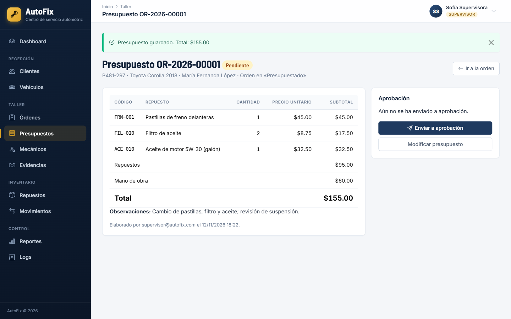
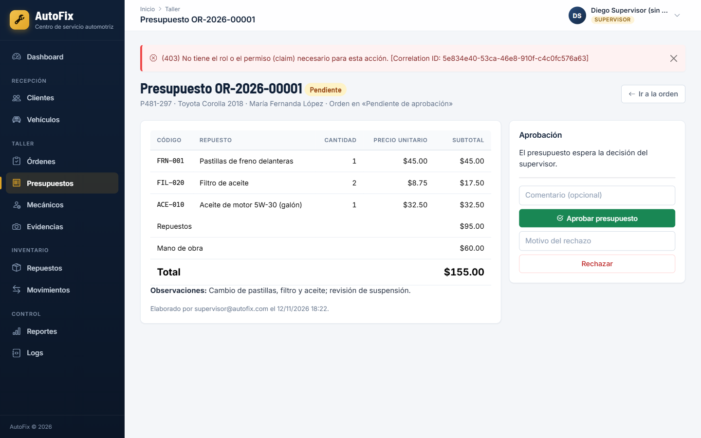

# AutoFix – Sistema de gestión de órdenes de reparación automotriz

Plataforma para un centro de servicio automotriz: clientes y vehículos, órdenes de reparación con flujo de estados, presupuestos, inventario de repuestos, fotografías de evidencia, mecánicos con agenda, reportes y auditoría.

- **AutoFix.Api**: ASP.NET Core Web API (.NET 10) con EF Core + SQLite, JWT, roles, claims, concurrencia optimista, imágenes y 3 middlewares de logs.
- **AutoFix.Mvc**: frontend ASP.NET Core MVC que **solo** consume la API por HTTP (`HttpClient`). No referencia EF Core ni la base de datos.
- **AutoFix.Contracts**: DTOs compartidos (clases simples, sin acceso a datos).
- **AutoFix.PruebaConcurrencia**: consola que lanza dos peticiones simultáneas con `Task.WhenAll` para demostrar los escenarios A y B.

```
AutoFix.sln
|-- AutoFix.Api/                 Web API: controladores, servicios, EF Core, middlewares
|   |-- Controllers/             Auth, Usuarios, Clientes, Vehiculos, Mecanicos, Ordenes,
|   |                            Presupuestos, Repuestos, Movimientos, Evidencias, Reportes, Logs
|   |-- Data/                    AutoFixDbContext (token de concurrencia) y DataSeeder
|   |-- Entities/                Entidades del modelo
|   |-- Exceptions/              BusinessException, NotFound, Conflict, Forbidden + mapeo a HTTP
|   |-- Logging/                 Cola de logs + escritor en segundo plano (archivo + SQLite)
|   |-- Middlewares/             CorrelationId, Excepciones, Registro de solicitudes
|   |-- Security/                JwtService, políticas (rol + claim)
|   |-- Services/                OrdenService, PresupuestoService, InventarioService, ImagenService
|   |-- Migrations/              (se generan con dotnet ef, ver paso 3)
|   `-- wwwroot/uploads/         Imágenes subidas (en la base solo se guarda la ruta)
|-- AutoFix.Mvc/                 MVC: vistas, controladores, ApiClient + JwtHandler (HttpClient)
|-- AutoFix.Contracts/           DTOs
|-- AutoFix.PruebaConcurrencia/  Demostración de concurrencia
|-- evidencias/                  Capturas y videos
`-- README.md
```

## Requisitos

| Herramienta | Uso |
|---|---|
| [.NET 10 SDK](https://dotnet.microsoft.com/download) | Compilar y ejecutar |
| Visual Studio Code + extensión **C# Dev Kit** | Editar y depurar |
| `dotnet-ef` (herramienta global) | Migraciones |
| DB Browser for SQLite (opcional) | Ver `autofix.db` |
| Postman o Swagger | Probar la API sin el MVC |

Verifique la versión con `dotnet --version` (debe empezar con `10.`).

## Instalación y ejecución

### 1. Clonar y restaurar

```bash
git clone <url-del-repositorio> AutoFix
cd AutoFix
dotnet restore AutoFix.sln
```

### 2. Instalar la herramienta de migraciones

```bash
dotnet tool install --global dotnet-ef
```

### 3. Crear la migración y la base de datos SQLite

Desde la carpeta raíz de la solución:

```bash
dotnet ef migrations add InicialAutoFix --project AutoFix.Api
dotnet ef database update --project AutoFix.Api
```

Esto crea `AutoFix.Api/Migrations/` (se sube al repositorio) y el archivo `AutoFix.Api/autofix.db`.
Atajo: `./setup.sh` (macOS/Linux/Git Bash) o `.\setup.ps1` (PowerShell) hacen los pasos 1 a 3.
En VS Code también están las tareas **ef: crear migración inicial** y **ef: actualizar base de datos** (`Ctrl+Shift+P` → *Run Task*).

> Si cambia el modelo y la migración falla por limitaciones de `ALTER TABLE` de SQLite, borre la carpeta `Migrations` y el archivo `autofix.db`, y repita el paso 3.

Al iniciar por primera vez, la API carga datos de prueba (usuarios, mecánicos, un cliente con dos vehículos y repuestos).

### 4. Ejecutar la API y el MVC

**Opción A – VS Code (recomendada):** abra la carpeta `AutoFix` en VS Code, vaya a *Run and Debug* (`Ctrl+Shift+D`), elija **API + MVC** y presione `F5`. Se abren Swagger y el MVC.

**Opción B – dos terminales:**

```bash
# Terminal 1
cd AutoFix.Api
dotnet run

# Terminal 2
cd AutoFix.Mvc
dotnet run
```

| Proyecto | URL |
|---|---|
| API (Swagger) | http://localhost:5080/swagger |
| MVC | http://localhost:5090 |

El MVC lee la dirección de la API en `AutoFix.Mvc/appsettings.json` → `Api:BaseUrl`.

### Llave JWT

`appsettings.json` **no** contiene llave. Para desarrollo hay una llave de prueba en `appsettings.Development.json` (marcada *SOLO-DESARROLLO*). Para usar una propia sin subirla al repositorio:

```bash
cd AutoFix.Api
dotnet user-secrets set "Jwt:Key" "una-llave-larga-de-al-menos-32-caracteres"
```

En producción se usa la variable de entorno `Jwt__Key`.

## Usuarios de prueba

| Rol | Correo | Contraseña | Permisos (claims) |
|---|---|---|---|
| Administrador | admin@autofix.com | Admin123! | Todos |
| Recepcionista | recepcion@autofix.com | Recepcion123! | Ordenes.Crear, Ordenes.Editar |
| Mecánico | mecanico@autofix.com | Mecanico123! | Ordenes.Editar |
| Mecánico | mecanico2@autofix.com | Mecanico123! | Ordenes.Editar |
| Supervisor | supervisor@autofix.com | Supervisor123! | Editar, Asignar, Aprobar, Finalizar, Inventario.Gestionar, Reportes.Consultar |
| Supervisor **sin** permiso de aprobar | supervisor2@autofix.com | Supervisor123! | Igual que el anterior pero sin `Ordenes.Aprobar` |
| Cliente | cliente@autofix.com | Cliente123! | Ninguno (solo consulta lo suyo) |

`supervisor2` sirve para demostrar que la autorización por **claim** funciona aunque el **rol** sea correcto: al aprobar un presupuesto recibe **403**.
Los clientes también pueden registrarse desde la pantalla de login.

## Cómo cumple cada módulo

| Módulo | Implementación |
|---|---|
| 1. Seguridad | `POST /api/auth/registro`, `POST /api/auth/login` (JWT HS256). Política de respaldo: todo endpoint exige token (sin token → **401**). Políticas que combinan rol + claim en `Security/Politicas.cs` (ej. `PuedeAprobar` = Supervisor/Administrador **y** `permiso=Ordenes.Aprobar`). El administrador edita permisos en *Usuarios*. |
| 2. Clientes y vehículos | Relación 1 a N. DUI, placa y chasis únicos. Foto del vehículo. |
| 3. Órdenes | Número `OR-AAAA-00001`, 9 estados, historial de cambios (quién y cuándo). El backend valida las transiciones (no se saltan pasos) y rechaza órdenes duplicadas (mismo vehículo + mismo servicio con orden activa) dentro de una transacción. Cliente ve solo sus órdenes; mecánico solo las asignadas. |
| 4. Presupuestos | Mano de obra + repuestos (cantidad, precio unitario, subtotal) + total. Aprobación/rechazo por supervisor. Al **iniciar la reparación** se descuentan automáticamente los repuestos en la misma transacción que el cambio de estado; si se cancela, regresan al inventario. |
| 5. Inventario | CRUD, entradas, salidas, movimientos con existencia anterior/resultante, alerta de stock mínimo (dashboard, inventario y respuesta de la salida). `CHECK (Existencias >= 0)` en la tabla. |
| 6. Concurrencia | Token `Version` (Guid + `[ConcurrencyCheck]`) en `Repuesto`, `Mecanico` y `OrdenReparacion`, renovado en `SaveChanges`. Transacciones explícitas. `DbUpdateConcurrencyException` → **409**. Ver detalle abajo. |
| 7. Imágenes | JPG/JPEG/PNG, máx. 5 MB, verificación de la firma del archivo, nombre `Guid + extensión`, guardadas en `AutoFix.Api/wwwroot/uploads/{vehiculos|repuestos|evidencias}`. En SQLite solo la ruta. Envío `multipart/form-data`. |
| 8. Middlewares y logs | Orden: Correlation ID → Excepciones → Registro de solicitudes → Autenticación → Autorización → Controladores. Cada petición a `/api` se registra con usuario, método, endpoint, fecha, código, duración, Correlation ID y excepción, en `AutoFix.Api/logs/autofix-AAAAMMDD.log` y en la tabla `LogsSolicitudes` (consultable en `GET /api/logs` y en la vista *Logs*). |

### Concurrencia con SQLite

- SQLite no genera `RowVersion`; se usa `public Guid Version` con `[ConcurrencyCheck]` y `AutoFixDbContext` asigna un Guid nuevo a cada entidad modificada antes de guardar. EF Core genera `UPDATE ... WHERE Id = @id AND Version = @versionLeida`.
- **Escenario A (inventario):** `InventarioService.RegistrarSalidaAsync` lee el repuesto, valida existencias y, dentro de una transacción, descuenta y registra el movimiento. Si otro usuario descontó primero, el `UPDATE` no afecta filas → `DbUpdateConcurrencyException` → rollback → **409**. Si la petición llega cuando ya no hay unidades → **400** "Existencias insuficientes". La versión que vio el usuario también puede enviarse (`version`); si ya cambió → **409**.
- **Escenario B (asignación):** `OrdenService.AsignarMecanicoAsync` valida que el horario no se cruce (`nuevoInicio < finExistente && inicioExistente < nuevoFin`) y, dentro de la transacción, modifica la fila del mecánico (`UltimaAsignacion`) para cambiar su `Version`. Si dos supervisores asignan a la vez, el segundo recibe **409**.
- `Default Timeout=30` en la cadena de conexión y modo WAL evitan el error *database is locked*.

## Pruebas obligatorias (guía rápida)

| # | Cómo hacerla | Resultado esperado |
|---|---|---|
| 1 | MVC como `recepcion@` → Clientes → Nuevo cliente → Agregar vehículo → **Guardar y agregar otro vehículo** | Cliente con 2 vehículos |
| 2 | Órdenes → Nueva orden | Orden en estado **Recibido** |
| 3 | Como `supervisor@` → Detalle de la orden → Asignar mecánico | Orden con mecánico asignado |
| 4 | Como `cliente@` en Swagger: `PUT /api/ordenes/{id}` (o `supervisor2@` aprobando un presupuesto) | **403** |
| 5 | Detalle → Iniciar diagnóstico → Crear presupuesto | Subtotales y total |
| 6 | Enviar a aprobación → como `supervisor@` → Aprobar | Estado **Aprobado** |
| 7 | Detalle de la orden → Subir foto (tipo *Daño identificado*) | Imagen en `wwwroot/uploads/evidencias` y ruta en la tabla `Evidencias` |
| 8 | Inventario → repuesto → Registrar salida (o *Iniciar reparación* en una orden aprobada) | Existencias actualizadas + movimiento |
| 9 | Registrar una salida mayor a las existencias | Error claro, existencias sin cambios |
| 10 | `dotnet run --project AutoFix.PruebaConcurrencia` (con la API corriendo) o dos pestañas de Swagger con la misma petición y la misma `version` | Una aplicada; la otra **409** |
| 11 | Swagger sin *Authorize*: `GET /api/clientes` | **401** |
| 12 | Vista *Logs* (filtro *Solo errores* o por Correlation ID) | Usuario, endpoint, código y Correlation ID |

Para probar en Swagger: ejecute `POST /api/auth/login`, copie el `token`, presione **Authorize** y péguelo.

## Endpoints principales

| Método | Ruta | Autorización |
|---|---|---|
| POST | `/api/auth/login`, `/api/auth/registro` | Anónimo |
| GET | `/api/auth/perfil` | Autenticado |
| GET/POST/PUT | `/api/usuarios`, `/api/usuarios/{id}/permisos` | Administrador |
| GET/POST/PUT/DELETE | `/api/clientes`, `/api/vehiculos` (+ `POST /{id}/foto`) | Empleados / Admin-Recepción |
| GET/POST/PUT/DELETE | `/api/mecanicos`, `GET /api/mecanicos/{id}/asignaciones` | Empleados / Admin |
| GET/POST | `/api/ordenes` | Lectura filtrada por rol / `Ordenes.Crear` |
| PUT | `/api/ordenes/{id}` | `Ordenes.Editar` |
| POST | `/api/ordenes/{id}/estado` | `Ordenes.Editar` |
| POST | `/api/ordenes/{id}/asignar` | Supervisor/Admin + `Ordenes.Asignar` |
| POST | `/api/ordenes/{id}/finalizar` | Supervisor/Admin + `Ordenes.Finalizar` |
| POST | `/api/ordenes/{id}/cancelar` | Supervisor/Admin + `Ordenes.Editar` |
| GET/POST | `/api/ordenes/{id}/presupuesto` | Lectura propia / `Ordenes.Editar` |
| POST | `/api/presupuestos/{id}/enviar` | `Ordenes.Editar` |
| POST | `/api/presupuestos/{id}/aprobar`, `/rechazar` | Supervisor/Admin + `Ordenes.Aprobar` |
| GET/POST/PUT/DELETE | `/api/repuestos` (+ `/foto`, `/entradas`) | `Inventario.Gestionar` para escribir |
| POST | `/api/repuestos/{id}/salidas` | Mecánico/Supervisor/Admin + `Ordenes.Editar` |
| GET | `/api/movimientos`, `/api/repuestos/alertas` | Empleados |
| POST/GET | `/api/ordenes/{ordenId}/evidencias`, `GET /api/evidencias` | `Ordenes.Editar` / Empleados |
| GET | `/api/reportes/dashboard` | Autenticado |
| GET | `/api/reportes/ordenes`, `/mecanicos`, `/inventario`, `/api/logs` | Supervisor/Admin + `Reportes.Consultar` |

## Vistas del MVC

Login (y registro de clientes), Dashboard, Clientes, Vehículos, Órdenes, Detalle de orden, Presupuestos, Mecánicos (con agenda), Inventario, Movimientos, Evidencias, Reportes, Logs y Usuarios.
El menú y los botones se muestran según el rol, pero la seguridad real está en la API: si alguien fuerza una acción, la API responde 401/403 y el MVC muestra el mensaje con su Correlation ID.

## Notas

- El MVC envía el JWT en cada petición mediante un `DelegatingHandler` (`AutoFix.Mvc/Services/JwtHandler.cs`) y también un `X-Correlation-ID`, así una acción del MVC se puede rastrear en los logs de la API.
- Los `decimal` se guardan como texto en SQLite; por eso las sumas de dinero de los reportes se calculan en memoria.
- Si `dotnet restore` reporta que no encuentra una versión de paquete, actualícela con `dotnet add AutoFix.Api package <Paquete>` (por ejemplo `Swashbuckle.AspNetCore`).

## Evidencias

Las capturas y videos de las 12 pruebas se guardan en la carpeta [`evidencias/`](evidencias/).

| Prueba | Captura |
|---|---|
| 1. Cliente con dos vehículos |  |
| 2. Orden en estado Recibido |  |
| 3. Mecánico asignado |  |
| 4. Modificar orden sin permisos → 403 |  |
| 5. Presupuesto con subtotales y total |  |
| 6. Aprobar sin claim `Ordenes.Aprobar` → 403 |  |

Las pruebas restantes (6 a 12) están listadas como pendientes en [`evidencias/README.md`](evidencias/README.md).
